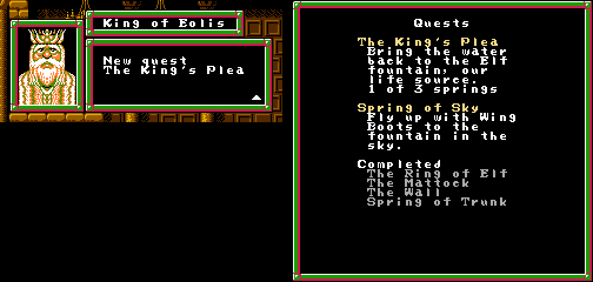
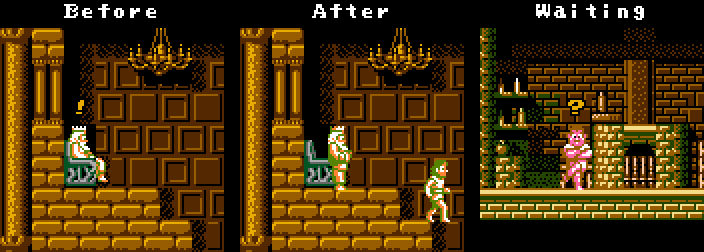

# Faxanadu Remastered

A remaster of Faxanadu (NES) that keeps as much of the real game as possible,
and fixes what has aged.

## Goals

- **The real game underneath.** It runs Faxanadu's own code, built from your
  ROM, so the world, music, story and feel are the original's. The remaster
  steers the game from outside; it doesn't rewrite it.
- **Quality of life.** Conveniences the 1987 game lacks, like saving without
  writing down mantras and travelling between Gurus. Where the game can offer
  them itself, it does, in its own text box and voice.
- **Combat, tuned with care.** Combat may be adjusted to be a bit more fun,
  without losing what makes Faxanadu feel like Faxanadu.
- **The original, one switch away.** Everything below is one mod, Faxanadu
  Remastered, on by default. Switch it off in the launcher's Mods screen and
  you play the original game, mantras and all.

How the game works, as far as we've learned it, is in
[docs/GAME_INTERNALS.md](docs/GAME_INTERNALS.md).

## What's new

### A quest log

Faxanadu's people tell you where to go and what to find, but nothing says
which lines matter, and they are easy to forget. Now when someone asks
something of you, the text box adds "New quest" and its name after their
line, and "Quest complete" when it is done: the King's plea for the
fountain's water, the Ring of Elf, the Mattock and the wall, the three
springs, the path to Mascon, the meteorite, the Battle Suit, the rings of
Dworf and the Demon, and the Evil One, 17 in all. Chatter stays chatter.
Press L, or the right stick on a controller, and the game pauses on your
quests: the ones under way with what to do, then the ones done. Your file
keeps them.



A gold "!" floats over anyone with a quest for you, and a "?" over the one
you should see next.



### The map

Press M, or the left trigger on a controller, and the game pauses on a map of
where you have been, as in Metroid: a box for every screen you have stood on,
laid out by how the screens join, with the one you are on blinking. Screens
you haven't seen stay blank. Each region, tower and castle has its page, the
towns sitting between the screens they join; Left and Right turn the page,
and B, Start or M close the map. It marks only what matters: a cross for each
Guru you have visited, a block for every other door you have gone through,
and a dot wherever an item still lies on a screen you have seen, gone once you
pick it up (one that turns up only now and then shows only while it is
there). Ladders you have climbed join the screens above and below. Your file
keeps the map, and the items you have taken.


### Seamless

Seamless is a separate option in the launcher's Mods screen, marked
Experimental and off by default. It is a way to view the game rather than
part of the remaster, so it has a switch of its own. It joins connected rooms
into one continuous world, keeps neighboring rooms' actors moving, and fits
the view to your window. The mouse wheel changes the pixel zoom, and F4 shows
the connected map. It is still a preview, for local play only. See
[docs/SEAMLESS-WORLD.md](docs/SEAMLESS-WORLD.md).


## Also new

### Saving and the Gurus

- **Save files.** Three files, as in Zelda. The title keeps NEW GAME and
  CONTINUE: NEW GAME asks which file to start in, and asks before erasing a
  used one, and CONTINUE picks a saved file and continues it exactly as you
  left it. A Guru no longer gives a mantra: he offers to remember your
  journey, and you continue at the last Guru you saved with.
- **Guru travel.** A temple's Guru can send you to any other Guru you have
  visited, keeping your HP, MP and gold.
- **Zone respawn.** After a death you come back where you last entered the
  tower, castle, town or region you died in, instead of at a temple.
- **Death keeps gold.** The Guru brings you back with all your gold and
  experience, instead of your title's starting amounts.

### Combat

- **Block.** Hold V, or B on a controller, with a shield or the Battle Helmet
  to raise it and stop enemy magic from the front, and Sugata's flash from any
  side. You glint in the shield's colors as you raise it.
- **Magic button.** C, or Y on a controller, casts your selected spell, as
  Up+B does, but without going through a door, talking to anyone or swinging
  your sword.
- **MP that refills.** Four seconds after your last spell, your MP starts to
  climb back toward full, a point every half second.
- **Damage numbers.** Every hit that takes HP shows how much, floating up from
  where it landed: white for the damage you deal, pink for the damage you take.
- **A taller dagger.** The Hand Dagger's swing reaches as low as the swords',
  so it hits low enemies like the Zozura outside Eolis. It keeps its short
  reach.
- **Sugata's flash, made fair.** Sugata, in the Mist, blinks before it flashes
  and dims the band of the screen the flash will reach, and the flash hurts
  only there, where it used to hit you anywhere, Ointment or not. With the
  Magic Shield, Block turns it back on Sugata.
- **Weapons indoors.** In shops, houses and temples the Select menu equips
  what you choose and you keep your weapon in hand, and your sword hurts the
  few enemies indoors, in the Mist and Dartmoor.
- **Fair entrances.** Some enemies stood right where a door, a ladder, a
  screen's edge or the bottom of a drop puts you, and hit you before you could
  react. They start a little way off now; every other enemy is where the
  original puts it.

### Getting around

- **Forgiving jumps.** A pressed up to 5 frames after you walk off a ledge
  still jumps, and up to 6 frames before you land jumps as you land. Walking
  off a ledge shows the jump pose, instead of walking on air.
- **Holding on to ladders.** A hit while you're on a ladder no longer knocks
  you off it.
- **Zone names.** Entering a different town, region, tower or castle shows its
  name below the status bar for about two seconds.

### Items and shops

- **Keys and tools.** Up at a locked door opens it with the right key from
  your inventory, without selecting it, and keys and the Mattock are no longer
  used up.
- **Items that recharge.** The Wing Boots and the Hour Glass recharge after
  use, counting down on the status bar, and the Wing Boots fly longer as your
  title rises. The Elixir stays with you after it revives you, and a Guru
  recharges it and tells you so; the first Guru you bring it to tells you he
  can.
- **Quick shops.** Up on a shopkeeper opens his list at once, Select switches
  between buying and selling, and you stay in the list after each sale. Any
  shop buys what you carry, except what you own for good, like a key or the
  Wing Boots: it says OWNED and isn't for sale.

### Text and the title

- **Faster text.** Hold A and text types 4 times as fast. A page break or a
  question still waits for a fresh press of A, so you never skip a page.
- **Speaker names.** Someone with a portrait is named on a tab above the
  dialogue box, as the game names them: "Guru of Apolune", "King of Eolis".
- **Slain by.** When something takes your last HP, a banner names it while you
  fall: "Slain by a Sugata", "Slain by Poison".
- **REMASTERED on the title.** The title screen shows REMASTERED under the
  FAXANADU logo, in the game's font and the logo's light yellow.

## Bugs fixed

The remaster also fixes these bugs in the original game:

- The Pendant was meant to make your weapon hit a quarter harder, but a
  reversed check gave that bonus to everyone without it, and finding the
  Pendant took it away. Now the bonus comes with the Pendant.
- A shot on your shield still let its share through and knocked you back when
  nothing should have hurt you: with Ointment, or in the second after a hit.
  Now the shield takes it, and you take nothing.
- Picking up the Battle Suit counted your weapons instead of your armor, and
  the Dragon Slayer your armor instead of your weapons, so either could wipe
  out what you carried or list what you didn't have. Now each joins its own
  list.
- Finding a Mattock, Wing Boots, an Hour Glass or a Red Potion with eight
  items listed said you got it, then lost it, and Ripasheiku's Mattock stayed
  gone until you died. Now the find stays where it lies, with a buzz, until
  you have room.
- Holding Up at the top of a ladder bobbed you a pixel past its end and back
  for as long as you held it. Now you stop at the top, and A jumps from there.
- Stepping onto the dried fountain's screen and straight back off dropped the
  fountain's ladder into the next screen, through its floor. Now it drops only
  on its own screen.
- Five graphics glitches are drawn as they were meant to be: a stray tile on
  the hero's chest on a ladder in Studded Mail, a piece of the Fire spell's
  first frame in its second, the Myconid's foot flickering into the wrong
  colors, a wall block in the Tower of Fortress's floor, and the grey tip of
  the F in the title's logo.
- The typing sound read past the end of its own table, so every character
  ended in a loud clack. Now it plays the softer sound the table holds.

## Controls

| | Keyboard | Controller |
|---|---|---|
| Move | Arrow keys | D-pad |
| A (jump) | Z | A |
| B (attack) | X | X |
| Start | Enter | Start |
| Select | Backslash | Back |
| Magic | C | Y |
| Block (hold, with a shield) | V | B |
| Map | M | Left trigger |
| Quest log | L | Right stick (press) |
| Menu | Escape | Right shoulder |
| Fast-forward (hold) | Tab | Right trigger |
| Save states | F7 | Back + left stick |
| Rewind | F8 | Back + right stick |
| Fullscreen | F11 | |
| Screenshot | F12 | |

On the title, Select or the D-pad moves between NEW GAME and CONTINUE, A or
Start chooses, and B goes back from the list of files.

The launcher's Controls page remaps them. To rebind Magic, Block, the Map or
the Quest log, set `MagicKey`, `BlockKey`, `MapKey` and `QuestLogKey` (a key
name, like `V` or `Left Shift`) and `MagicButton`, `BlockButton`, `MapButton`
and `QuestLogButton` (a controller button, like `b` or `leftshoulder`, or a
trigger, like `lefttrigger+`) in the `[Game]` section of `config.ini`, next
to the game. `none` unbinds one. Pick ones nothing else
uses.

## Save files

Your three files are `faxanadu_file1.txt` to `faxanadu_file3.txt`, next to
the game. Block remembers that it has shown its line in `faxanadu_block.txt`
beside them.

The remaster has no mantras: it neither shows nor reads them. Switch it off
and the original's CONTINUE asks for one, as it always did.

## The ROM it needs

The remaster is built from your own copy of **Faxanadu (USA)**; it ships no
game data. The build checks the ROM and rejects any other, including **Faxanadu
(USA) (Rev A)**, a different revision.

| | ROM data only, iNES header excluded |
|-------|-------|
| CRC32 | `57DD23D1` |
| MD5   | `b3bb9296b5e1e0c83e90b6da9e8a41aa` |
| SHA-1 | `5b05c8859f356013d37f0545f5de5fa1693da5da` |

## Building and running on Linux

The Nix flake's devShell (`flake.nix`) has everything the build needs. With
[direnv](https://direnv.net/), `direnv allow` loads it whenever you enter the
repo; otherwise run the commands inside `nix develop`. Put your ROM at the
repo root as `Faxanadu (USA).nes` (`*.nes` is gitignored).

```bash
git clone https://github.com/cdmckay/faxanadu-remastered
cd faxanadu-remastered
./setup.sh
direnv allow
cmake -S . -B build-cycle -DCMAKE_BUILD_TYPE=Release -DNESRECOMP_ROM="$PWD/Faxanadu (USA).nes"
cmake --build build-cycle -j"$(nproc)"
build-cycle/FaxanaduRecomp "Faxanadu (USA).nes"
```

`setup.sh` fetches the code the build depends on. The game opens in its
launcher first.

The game's C is in `src/` (each feature is a `fax_<name>.c`), its tests in
`tests/`, the mod in `mods/`, scripts in `tools/` and notes in `docs/`.
`tools/readme_screenshots.py` plays the quest log, the map and Seamless from
your ROM to make the screenshots above.

## Credits

- Built on Matthew Stanley's [FaxanaduRecomp](https://github.com/mstan/FaxanaduRecomp)
  and [nesrecomp](https://github.com/mstan/nesrecomp).
- [chipx86's annotated disassembly](https://github.com/chipx86/faxanadu) of
  Faxanadu, which every feature is built on.
- The Faxanadu 40th Anniversary Edition and Retranslation fan patches, for
  ideas.

## License

PolyForm Noncommercial 1.0.0, with the standing permissions in
[PERMISSIONS.md](PERMISSIONS.md); see [LICENSE](LICENSE). Third-party
components keep their own licenses.
