# Faxanadu Remastered

A remaster of Faxanadu (NES) that keeps as much of the real game as possible,
and fixes what has aged.

## Goals

- **The real game underneath.** It runs Faxanadu's own code, built from your
  ROM, so the world, music, story and feel are the original's. The remaster
  steers the game from outside; it doesn't rewrite it.
- **Quality of life.** Conveniences the 1987 game lacks, like saving without
  writing down mantras and travelling between Gurus. Where the game can offer
  them itself, it does, in its own text box and voice.
- **Combat, tuned with care.** Combat may be adjusted to be a bit more fun,
  without losing what makes Faxanadu feel like Faxanadu.
- **The original, one switch away.** Everything below is one mod, Faxanadu
  Remastered, on by default. Switch it off in the launcher's Mods screen and
  you play the original game, mantras and all.

How the game works, as far as we've learned it, is in
[docs/GAME_INTERNALS.md](docs/GAME_INTERNALS.md).

## What's new

### The title

**REMASTERED on the title.** The title screen shows REMASTERED under the
FAXANADU logo, in the game's own font and the light yellow of the logo. The
rest of the title is the original's.

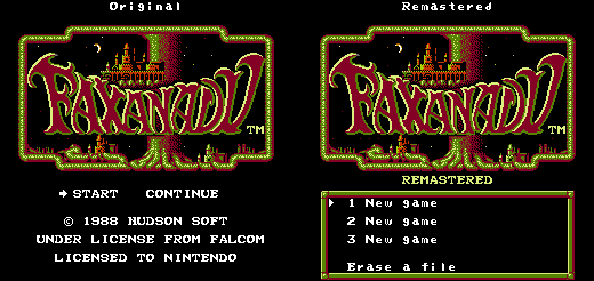

### Saving and the Gurus

**Save files.** The title screen offers three files, as in Zelda: pick an
empty one to start a new game, or a saved one to continue exactly as you left
it: title, gold, experience, items, quests and the Gurus you have met. "Erase
a file" clears one. A Guru no longer gives a mantra: he offers to remember
your journey, and the Guru you last saved with is where you continue, and
where you wake when there's no entrance to come back to. Talking to a Guru
without saving leaves that where it was. Your file is also saved each time
you come back from a death or a journey.

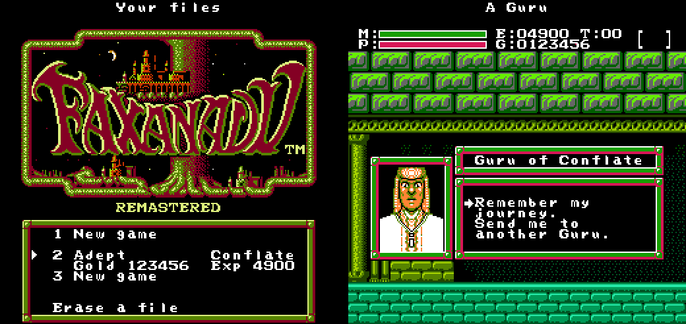

**Guru travel.** A temple's Guru can send you to any other Guru you have
visited: choose "Send me to another Guru." when he asks, or say yes after he
remembers your journey. A to go, B to hear the next town. HP, MP, gold and
your spawn point are kept.

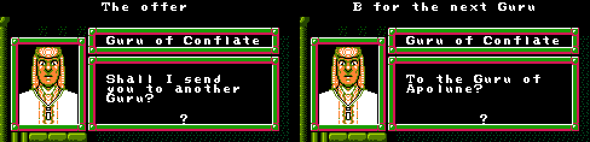

**Death keeps gold.** When you die, the Guru brings you back with all your
gold and experience, instead of your title's starting amounts. You still come
back with full HP and MP, and the timed items are gone, as before.

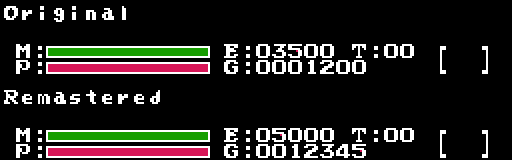

**Zone respawn.** After the Guru's words, you come back where you last
entered the tower, castle, town or region you died in, instead of at a
temple. Until you have entered one, and after continuing or a Guru's journey
until you walk out of the temple, you wake at the temple as before.

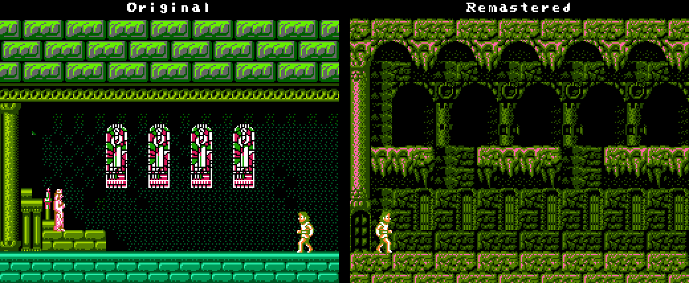

### Combat

**Block.** Hold V on the keyboard, or B on a controller, with a shield (or the
Battle Helmet) in hand to stand your ground and raise it: enemy magic from the
front, and Sugata's flash from any side, is stopped with the shield's sound.
Contact and sword damage are as before. As you raise it, you glint twice in
the shield's colors, so you can see you're blocking. The first time you get a
shield or the Battle Helmet, the game adds a line naming your key, once.

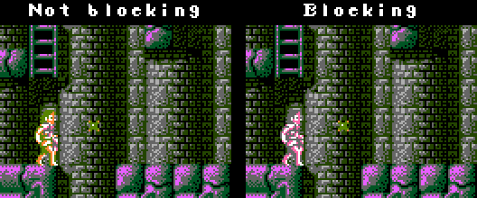

**Magic button.** C on the keyboard, or Y on a controller, casts your selected
spell, as Up+B does, but without going through a door, talking to anyone or
swinging your sword. Up+B still works.

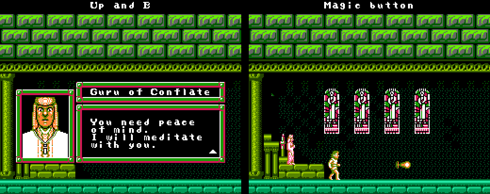

**Sugata's flash.** Sugata, in the Mist, blinks for half a second before it
flashes, and the band of the screen its flash will reach dims faintly. The
flash greys only that band and hurts only there: step out of it, or hold
Block. With the Magic Shield, Block turns the flash back on Sugata. Ointment
now keeps your HP, though the flash still knocks you back. In the original it
hit you anywhere on the screen, Ointment or not.

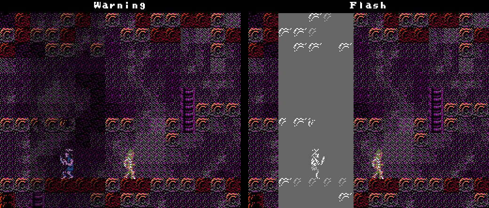

**The Pendant, fixed.** The Pendant was meant to make your weapon hit a
quarter harder, but a reversed check in the original gave that bonus to
everyone without it, and finding the Pendant took it away. Now your weapon
does its base damage until you find the Pendant, and the original's full
damage once you have it. The Glove adds its bonus as before.

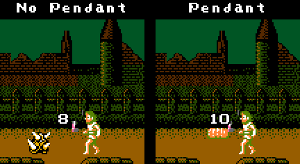

**Ointment and the shield, fixed.** Ointment kept enemy magic from hurting
you, except a shot that hit your shield: the shield still let its share
through and knocked you back. Now Ointment covers that too: the shield takes
the shot, and you take nothing.

**Damage numbers.** Every hit that takes HP shows how much, in the status
bar's own digits, floating up from where it landed and fading: white for the
damage you deal, with your weapon, your magic or a reflected flash, and pink
for the damage you take. A killing blow shows the whole hit. Hits that take
nothing, through Ointment, Block or a moment of invincibility, show nothing.

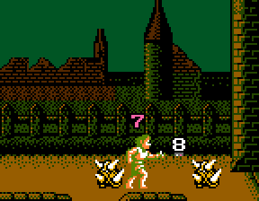

**A taller dagger.** The Hand Dagger used to swing over low enemies that every
sword hits, like the Zozura crawling outside Eolis. Now its swing reaches as
low as the swords', so it hits them. It keeps its short reach, so the Long
Sword is still an upgrade.

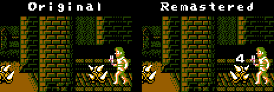

**Weapons indoors.** In shops, houses and temples the Select menu equips what
you choose, as it does outside, and you keep your weapon in hand: buy a sword
and swing it on the spot. Swinging at townsfolk does nothing, as before. In
the few rooms with enemies inside, in the Mist and Dartmoor, your sword now
hurts them too; in the original only magic did.

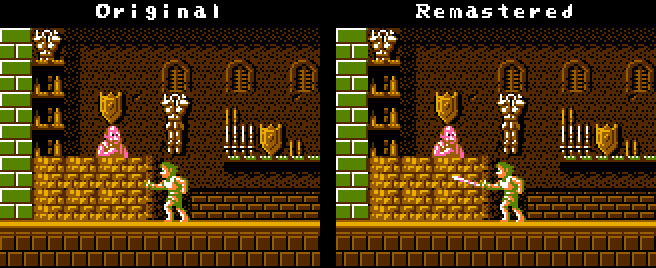

### Getting around

**The map.** Press M, or the left trigger on a controller, and the game
pauses on a map of where you have been, as in Metroid: a box for every screen
you have stood on, laid out by how the screens join, with the one you are on
blinking. Screens you haven't seen stay blank. Each region, tower and castle
has its page, the towns sitting between the screens they join; Left and Right
turn the page, and B, Start or M close the map. Marks show the doors you have
used: Gurus, shops, other buildings, and doors to towers, castles and other
regions. Ladders you have climbed join the screens above and below. Your file
keeps the map.

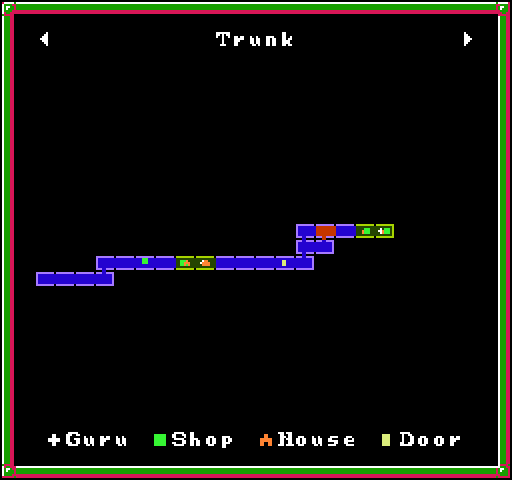

**Forgiving jumps.** A pressed up to 5 frames after you walk off a ledge still
jumps, from where you are, and A pressed in the air up to 6 frames before you
land jumps as you land. No jump goes higher or further than a well-timed one
in the original. The Wing Boots, ladders and knockback work as before, and
raising Block drops a press it was keeping, so you land standing your ground.

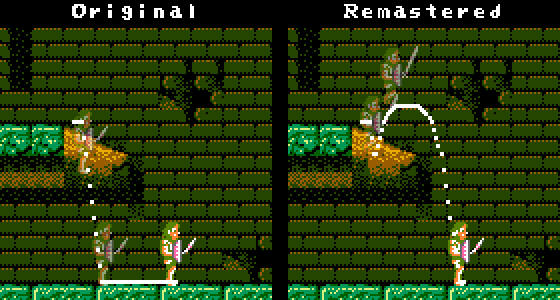

**A falling pose.** Walking off a ledge, the hero used to fall standing or
mid-step, as if walking on air. Now he shows the jump pose until he lands, as
in a jump.

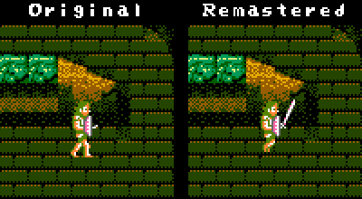

**Ladders, fixed.** Holding Up at the top of a ladder used to lift you a pixel
past its end, drop you, and lift you again, bobbing for as long as you held
it. Now you stop at the top, and A jumps from there as soon as you let go of
Up; the original jumped only if you let go right after a drop. And stepping
onto the dried fountain's screen, by the door to the Mist, and straight back
off dropped the fountain's ladder into the next screen, through its floor;
now it drops only on its own screen.

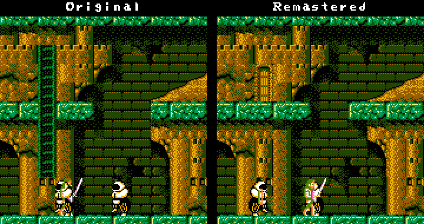

**Holding on to ladders.** A hit while you're on a ladder no longer knocks you
off it: you take the damage and hold on. On the ground, knockback is as
before.

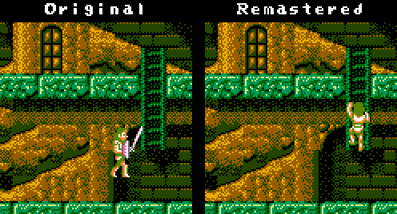

### Keys and items

**Keys that find themselves.** Press Up at a locked door and the right key
from your inventory opens it, without selecting it first; whatever item you
had selected stays selected.

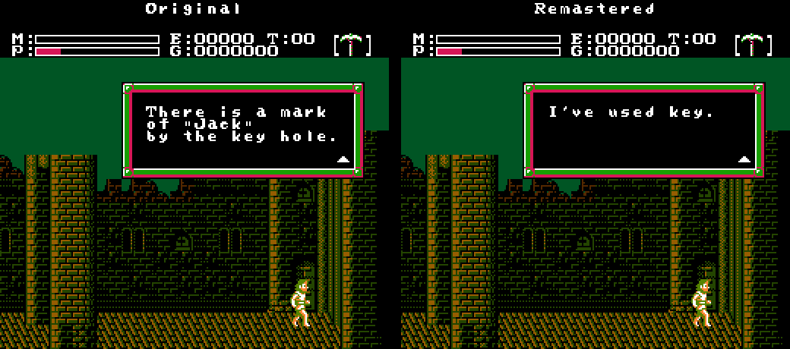

**Tools that last.** A key stays in your inventory after it opens a door, and
the Mattock after it breaks a wall. Potions and the other consumables are
still used up.

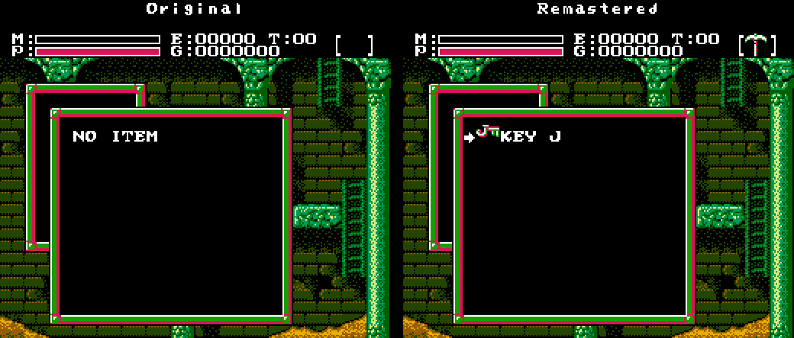

**Items that recharge.** The Wing Boots, the Hour Glass and the Elixir are
kept after use. The Wing Boots fly longer as your title rises (30, 40, 50 and
60 seconds, every four titles, where the original's flights got shorter),
then recharge for 60 seconds. The Hour Glass still stops time for 15 seconds
and costs half your HP, then recharges for 60 seconds. While one recharges,
T: on the status bar blinks the seconds left, and using it does nothing.
Dying makes both ready. The Elixir still revives you, then stays with you,
spent, until you talk to a Guru; the menu's Player page shows it only while
it is charged. Finding one you already own recharges it; buying does not, since
a shop won't sell you a second Elixir, charged or spent. Your save file keeps
the cooldowns and whether the Elixir is spent.

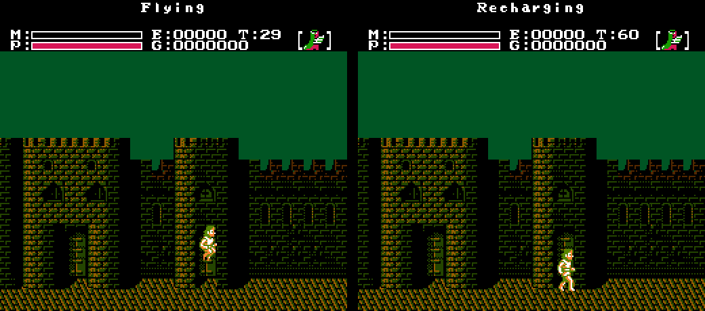

**The Battle Suit and the Dragon Slayer, fixed.** In the original, picking up
the Battle Suit counted your weapons instead of your armor, and the Dragon
Slayer your armor instead of your weapons, so either could wipe out armor or
weapons you carried, or list ones you didn't have. Now each joins its own
list, after what you carry.

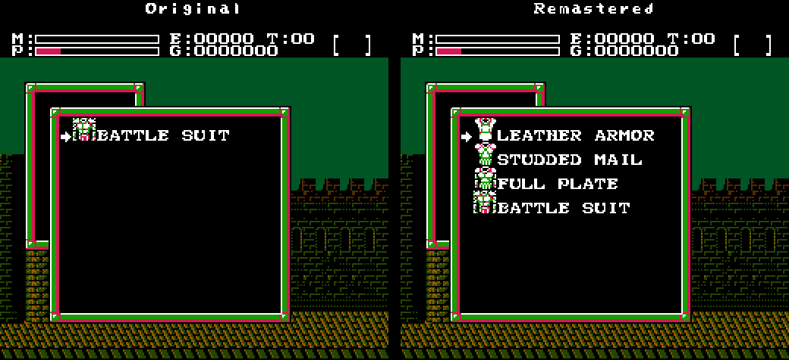

### Shops and text

**Quick shops.** Up on a shopkeeper opens his list straight away, with no
greeting or questions. Select switches between buying and selling, buying or
selling keeps you in the list with the cursor where it was, and B leaves.
Prices, what you can carry and "This is not enough Golds." are the game's own.
Any shop buys anything you carry: half its price where a shop sells it,
otherwise 100 Golds. Up from the top or Down from the bottom turns the page of
a long list. The Dragon Slayer, the Battle Suit and the Battle Helmet are not
for sale, and what you have equipped or selected is not offered, as before.
What you already have for good, the Wing Boots, the Hour Glass, the Elixir
(charged or spent), a key or the Mattock, keeps its place in a shop's list but
says OWNED instead of a price, and A on it does nothing.

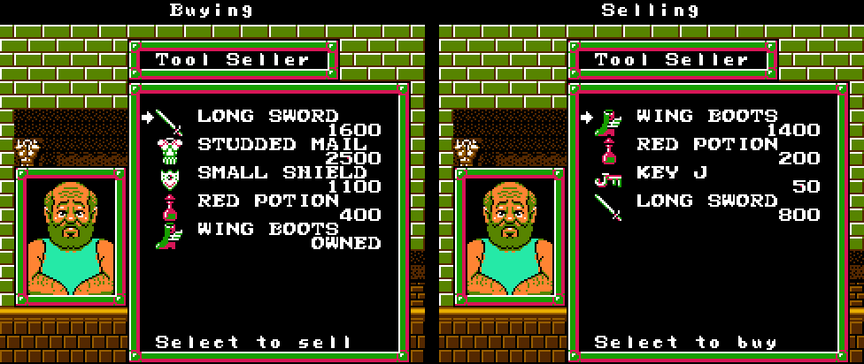

**Hold A to speed up text.** Text types at the game's own pace; hold A and it
types 4 times as fast. A page break or a question still waits for a fresh
press of A, so holding it never skips a page or answers for you: let go, then
press A to go on.

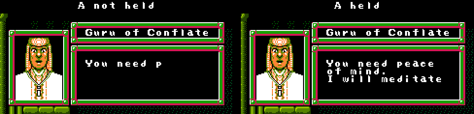

**The typing sound, fixed.** The original's typing sound reads past the end
of its own two-sound table, so every character ends in a loud clack. Now it
plays the softer sound the table holds.

**The mantra's line break, fixed.** Where a Guru's mantra starts its second
line was decided by a byte read from the wrong part of the ROM. In the
original that byte happens to work, but another would have put the second
line over the first. Now the break is certain. A Guru shows a mantra only
when no save file is in play.

**Zone names.** When you enter a different town, region, tower or castle, its
name appears below the status bar for about two seconds in the game's own
text box, as the dialogue names it ("Tower of Suffer", "Castle of
Fraternal"). Shops, houses and temples show nothing.

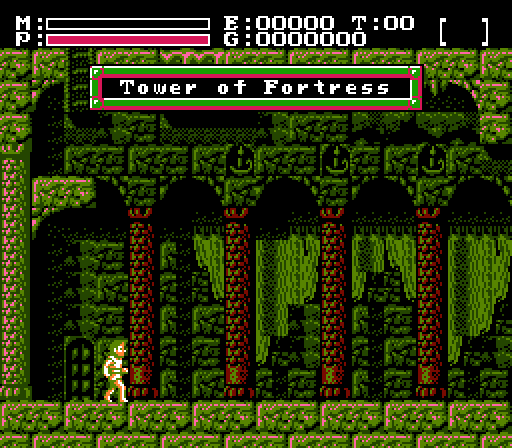

**Slain by.** When something takes your last HP, the same banner names it
while you fall: "Slain by a Sugata", "Slain by an Execution Hood", "Slain
by Poison". A shot or a falling rock is named after whoever cast it. The
Guru's words that follow are as before.

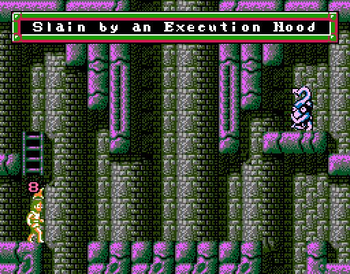

**Speaker names.** When someone with a portrait talks to you, their name sits
on a tab above the dialogue box for the whole conversation, as the game names
them: "Guru of Apolune", "King of Eolis", "Martial Artist", "Key Seller".
People without a portrait show no name.

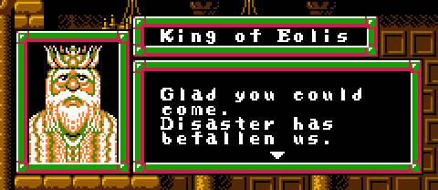

### A way to view it: Seamless

**Seamless** is a separate option in the launcher's Mods screen, marked
Experimental and off by default. It is a way to view the game rather than
part of the remaster, so it has a switch of its own. It joins connected rooms
into one continuous world, keeps neighboring rooms' actors moving, and fits
the view to your window. The mouse wheel changes the pixel zoom, and F4 shows
the connected map. It is still a preview, for local play only. See
[docs/SEAMLESS-WORLD.md](docs/SEAMLESS-WORLD.md).

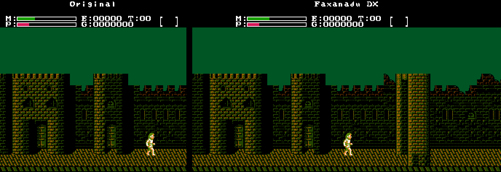

## Controls

| | Keyboard | Controller |
|---|---|---|
| Move | Arrow keys | D-pad |
| A (jump) | Z | A |
| B (attack) | X | X |
| Start | Enter | Start |
| Select | Backslash | Back |
| Magic | C | Y |
| Block (hold, with a shield) | V | B |
| Map | M | Left trigger |
| Menu | Escape | Right shoulder |
| Fast-forward (hold) | Tab | Right trigger |
| Save states | F7 | Back + left stick |
| Rewind | F8 | Back + right stick |
| Fullscreen | F11 | |
| Screenshot | F12 | |

The launcher's Controls page remaps them. To rebind Magic, Block or the Map,
set `MagicKey`, `BlockKey` and `MapKey` (a key name, like `V` or `Left Shift`)
and `MagicButton`, `BlockButton` and `MapButton` (a controller button, like
`b` or `leftshoulder`, or a trigger, like `lefttrigger+`) in the `[Game]`
section of `config.ini`, next to the game. `none` unbinds one. Pick ones nothing else
uses.

## Save files

Your three files are `faxanadu_file1.txt` to `faxanadu_file3.txt`, next to
the game. Block remembers that it has shown its line in `faxanadu_block.txt`
beside them.

Mantras from the original still work: the first time, your mantra in
`faxanadu.srm` (and the Gurus in `faxanadu_gurus.txt`) goes into file 1. To
bring in another, enter it in the launcher's Mantra field or pass
`--password`, and it goes into the first empty file. Each mantra comes in
once.

## The ROM it needs

The remaster is built from your own copy of **Faxanadu (USA)**; it ships no
game data. The build checks the ROM and rejects any other, including **Faxanadu
(USA) (Rev A)**, a different revision.

| | ROM data only, iNES header excluded |
|-------|-------|
| CRC32 | `57DD23D1` |
| MD5   | `b3bb9296b5e1e0c83e90b6da9e8a41aa` |
| SHA-1 | `5b05c8859f356013d37f0545f5de5fa1693da5da` |

## Building and running on Linux

The Nix flake's devShell (`flake.nix`) has everything the build needs. With
[direnv](https://direnv.net/), `direnv allow` loads it whenever you enter the
repo; otherwise run the commands inside `nix develop`. Put your ROM at the
repo root as `Faxanadu (USA).nes` (`*.nes` is gitignored).

```bash
git clone https://github.com/cdmckay/faxanadu-remastered
cd faxanadu-remastered
./setup.sh
direnv allow
cmake -S . -B build-cycle -DCMAKE_BUILD_TYPE=Release -DNESRECOMP_ROM="$PWD/Faxanadu (USA).nes"
cmake --build build-cycle -j"$(nproc)"
build-cycle/FaxanaduRecomp "Faxanadu (USA).nes"
```

`setup.sh` fetches the code the build depends on. The game opens in its
launcher first.

The game's C is in `src/` (each feature is a `fax_<name>.c`), its tests in
`tests/`, the mod in `mods/`, scripts in `tools/` and notes in `docs/`.
`tools/readme_screenshots.py` plays each feature from your ROM to make the
screenshots above.

## Credits

- Built on Matthew Stanley's [FaxanaduRecomp](https://github.com/mstan/FaxanaduRecomp)
  and [nesrecomp](https://github.com/mstan/nesrecomp).
- [chipx86's annotated disassembly](https://github.com/chipx86/faxanadu) of
  Faxanadu, which every feature is built on.
- The Faxanadu 40th Anniversary Edition and Retranslation fan patches, for
  ideas.

## License

PolyForm Noncommercial 1.0.0, with the standing permissions in
[PERMISSIONS.md](PERMISSIONS.md); see [LICENSE](LICENSE). Third-party
components keep their own licenses.
